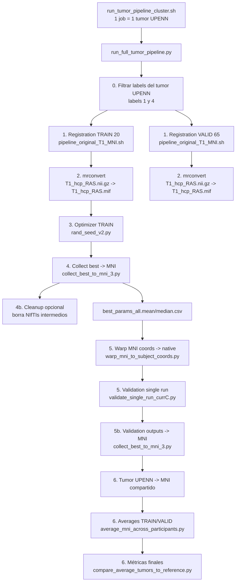

# Flujo del pipeline en el cluster

## Qué sí está cubierto ya

- **Conversión `nii.gz -> mif`**: no falta un script adicional si usas `run_full_tumor_pipeline.py`; el paso 2 llama a `mrconvert` internamente.
- **Tumor original en MNI**: tampoco falta un script aparte en el flujo principal; el paso 6 lo hace dentro de `run_full_tumor_pipeline.py` y lo guarda en `registration/tumor_upenn_MNI.nii.gz`.
- **CSV de métricas**:
  - training: `simulation.csv` por sujeto con métricas completas
  - validation: `metrics.csv` / `metrics.json` por sujeto
  - collect: `best_params_all.csv` y `validation_all.csv` arrastran las métricas del best/single run
  - average final: `avg_mni_outputs/average_vs_tumor_metrics.csv`

## Qué faltaba en el paquete original y queda añadido aquí

- Wrapper principal de cluster: `run_tumor_pipeline_cluster.sh`
- Plantilla Slurm para 15 tumores: `submit_tumor_array_15.slurm`
- Chequeo de inputs compartidos: `check_cluster_inputs.sh`
- Cleanup standalone del training: `cleanup_training_keep_best.py`

## Observación importante

El único paso repetitivo que **podría** optimizarse en el futuro es que el registro `UPENN -> MNI` se recalcula dentro de cada carpeta de sujeto HCP, aunque conceptualmente depende solo del tumor UPENN y del template MNI. No falta para ejecutar el pipeline, pero sí es una posible optimización futura.
